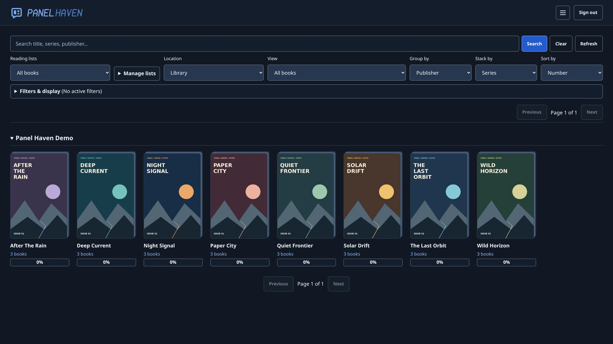
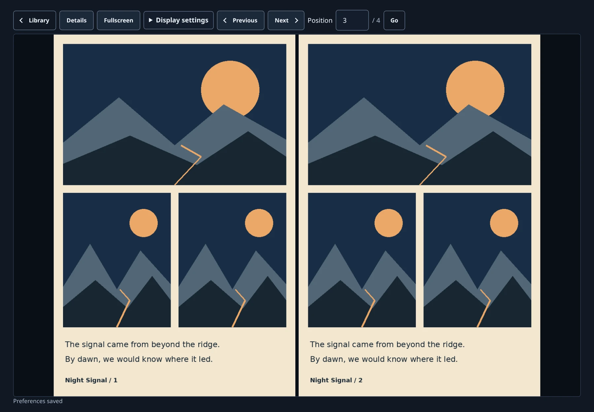

# Panel Haven

**A self-hosted comic library and browser reader with private progress for every reader.**

**[Support Panel Haven on Patreon](https://www.patreon.com/cw/Batman2099)**

Panel Haven is a standalone comicbook library and browser reader, built with ASP.NET Core, SQLite, and native JavaScript/CSS. Keep your comics on your server, browse a shared library, and read from a browser without installing a desktop application.

## Highlights

- Read **CBZ/ZIP, CBR/RAR, CB7/7z, and CBT/TAR** archives with single-page, continuous, and two-page views.
- Resume with private per-user progress, bookmarks, ratings, and reader preferences.
- Organize a shared collection with search, filters, series/folder browsing, manual lists, and smart lists.
- Import embedded ComicInfo/ComicBook metadata, edit catalog metadata independently, write saved changes to CBZ/ZIP, or explicitly convert a non-ZIP source to CBZ with saved metadata. Source replacements cannot be undone.
- Watch library folders automatically, report exact duplicates, and retain catalog history when files go missing.
- Manage administrator/reader accounts and perform live or offline backups, offline restores, and verified root relocation.

## Find your task

| Task | Start here |
| --- | --- |
| Preview the interface | [Screenshots](#screenshots) |
| Install and configure | [Docker installation](#docker-installation), [Quick start](#quick-start), [Configuration](#configuration) |
| Browse and read | [Working behavior](docs/reference.md#working-behavior), [Reader controls](docs/reference.md#reader-controls), [Reading lists](docs/reference.md#reading-lists) |
| Filter and discover | [Advanced filters](docs/reference.md#advanced-filters), [Catalog views](docs/reference.md#catalog-views), [Grouping and sorting](docs/reference.md#grouping-and-sorting) |
| Manage comicbooks | [Metadata and reading lists](docs/reference.md#metadata-and-reading-lists), [Process comicbooks](docs/reference.md#process-comicbooks), [Rename, move and recovery](docs/reference.md#rename-move-and-recovery), [Library maintenance](docs/reference.md#library-maintenance) |
| Manage access | [Account management](docs/reference.md#account-management), [Remote access](docs/reference.md#https-and-trusted-proxies) |
| Protect an installation | [Backup and restore](docs/reference.md#backup-restore-and-root-relocation), [Upgrade an existing installation](docs/reference.md#upgrading-an-existing-installation-to-panel-haven), [Safety](#safety-and-operating-limits) |
| Develop and contribute | [Development](#development), [Checks](#checks), [Verification history](docs/reference.md#verification-history), [Parity inventory](docs/reference.md#full-port-parity-inventory) |
| Get help and review licensing | [Help](#help-and-contributing), [License](#license-and-attribution) |

## Quick start

### Requirements

- [.NET 10 SDK](https://dotnet.microsoft.com/download/dotnet/10.0) for a source installation, or Docker Engine with the Compose plugin for the container installation.
- Git to clone the repository.
- A server-accessible folder containing supported comic archives and writable storage for application state.
- A modern browser. Node.js is only needed for the JavaScript development check.

The application uses one ASP.NET Core process and SQLite; no separate database server or frontend build is required. Library folders are configured on the server, not selected from the browser's local filesystem.

### Get the source

```bash
git clone https://github.com/batman-2099/PanelHaven.git
cd PanelHaven
```

### Docker installation

On Linux, the included [Dockerfile](Dockerfile) builds the application locally; [compose.yaml](compose.yaml) runs it as a non-root user with persistent state and library mounts. No host .NET SDK is needed.

1. Create a private state directory, separate from your comicbooks:

   ```bash
   install -d -m 700 "$HOME/.local/share/panelhaven-docker"
   id -u
   id -g
   ```

2. Create or edit `.env` in the repository root. Replace these examples with the UID/GID printed above and your actual absolute paths. Both directories must exist, and the selected non-root user must be able to access them.

   ```dotenv
   PANELHAVEN_UID=1000
   PANELHAVEN_GID=1000
   PANELHAVEN_STATE_DIR=/home/your-user/.local/share/panelhaven-docker
   PANELHAVEN_LIBRARY_DIR=/absolute/path/to/comics
   ```

3. Start the application with initial administrator credentials:

   ```bash
   chmod 600 .env
   export PANELHAVEN_ADMIN_USERNAME=admin
   read -rsp 'Initial administrator password (12–256 characters): ' PANELHAVEN_ADMIN_PASSWORD; echo
   export PANELHAVEN_ADMIN_PASSWORD
   docker compose config --quiet
   docker compose up -d --build
   docker compose logs --tail=100 panelhaven
   ```

Open <http://127.0.0.1:5178> on the Docker host and sign in. After confirming the account works, remove bootstrap credentials from the shell and recreate the container without them:

```bash
unset PANELHAVEN_ADMIN_USERNAME PANELHAVEN_ADMIN_PASSWORD
docker compose up -d --force-recreate
```

Accounts, signing keys, reading progress and saved settings remain in the state mount. The library mount is writable for explicit administrator file operations; protect your comicbooks separately. `.env` is ignored by Git and excluded from the image.

The default installation uses Linux host networking and listens only on loopback; remote access still requires HTTPS. Use `docker compose restart panelhaven` to restart, or `docker compose down` to stop and remove the container without deleting bind-mounted data. In-app systemd controls and scheduled-backup timers are unavailable in the container.

See the [Docker reference](docs/reference.md#docker-installation) for read-only libraries, permissions, HTTPS, backups, updates and verification limits. Back up before updating; then run `docker compose build --pull` followed by `docker compose up -d`.

### Linux (Bash)

Run from the repository root. Replace the library path with your own:

```bash
export PANELHAVEN_ADMIN_USERNAME=admin
read -rsp 'Initial administrator password (12–256 characters): ' PANELHAVEN_ADMIN_PASSWORD; echo
export PANELHAVEN_ADMIN_PASSWORD
export Libraries__0=/absolute/path/to/comics
# Optional additional roots: export Libraries__1=/another/path
# Optional state location: export DataPath=/absolute/path/to/private-state
dotnet run --project web/PanelHaven.Web.csproj --urls http://127.0.0.1:5178
```

Open <http://127.0.0.1:5178> and sign in with the credentials you supplied. Configured folders scan automatically at startup and after changes; **Scan libraries** remains available for an immediate manual scan. No sample books or default credentials are installed.

The sign-in page uses a visible **Sign in** heading above the username and password form; the Panel Haven logo remains in the header.

> [!WARNING]
> These commands start a **local-only** server. Before enabling remote access, configure [HTTPS and trusted proxies](docs/reference.md#https-and-trusted-proxies) and review the [operating limits](#safety-and-operating-limits). Every authenticated user can read the entire configured library.

## Configuration

App-owned environment variables use `PANELHAVEN_`; the application project is `PanelHaven.Web`. Existing installations must complete the [offline rename migration](docs/reference.md#upgrading-an-existing-installation-to-panel-haven) before starting this version. Old names are not accepted as aliases.

Administrator credentials are required only when the accounts database is empty. Subsequent launches use stored password hashes; changing these environment variables does **not** reset an existing password. Remove them from your environment after initialization. Use the [account controls](docs/reference.md#account-management) for password changes and administrator resets. Email/self-service recovery is not implemented; retain administrator credentials securely.

Initial configuration uses ASP.NET Core's environment-variable/command-line providers. `Libraries__0`, `Libraries__1`, etc. are server-side paths. Relative bootstrap roots and `DataPath` resolve from the application's content root (`web/` when using the commands above). Default state is `web/data/`, with the database at `DataPath/panelhaven.sqlite` and persistent signing keys in `DataPath/keys`. Administrators can subsequently manage configuration through **Server settings**.

For managed settings, secrets, startup and data relocation, see [Web-based server administration](docs/reference.md#web-based-server-administration).

## Safety and operating limits

The test installation supports LAN HTTPS, but public deployment still requires trusted TLS, firewall rules, protected secrets and an operational security review. Web settings do not configure the firewall or issue certificates. All users share access to all books; library-specific permissions are not implemented.

The private state directory contains SQLite data and persistent cookie-signing keys. Keys are not encrypted at rest by the application; protect this directory with OS permissions and encrypted storage where needed. Keep it outside publicly served folders. Use the [live/offline backup and offline restore commands](docs/reference.md#backup-restore-and-root-relocation); do not copy only the live SQLite main file while WAL writes are active.

Source replacement and permanent deletion cannot be undone. Application-state backups do not contain comicbook files; protect those files separately. See the [full operating limits](docs/reference.md#safety-and-operating-limits) and [backup, restore and recovery instructions](docs/reference.md#backup-restore-and-root-relocation) before changing stored data.

## Development

### Repository layout

- [`web/`](web/) — ASP.NET Core application, SQLite storage, and browser assets in [`web/wwwroot/`](web/wwwroot/).
- [`web-checks/`](web-checks/) — console-based behavioral checks, synthetic archive fixtures, and the JavaScript reader check.
- `upstream/` — optional local reference checkout; ignored by Git, not included in this repository, and not a build or runtime dependency.

Build from the repository root:

```bash
dotnet build web/PanelHaven.Web.csproj
```

### Checks

```bash
dotnet run --project web-checks/PanelHaven.Checks.csproj
node web-checks/reader-check.mjs
```

The retained checks exercise real temporary archives/databases: pagination boundaries and stable ordering, natural number sorting, per-user status/publisher filters, unchanged-file skipping without archive reopening, changed-file preservation, cancellation/resumption, bounded errors, thumbnail dimensions/colors/orientation/first frame, cache reuse/invalidation, unsafe images/archives, metadata preservation, account validation and persisted/validated per-user reader preferences. The dependency-free JavaScript check covers spread grouping, forward/back boundaries, landscape splitting and swipe decisions. Node.js is needed only for that check, not to run the application. These checks do not change your configured library.

See the [browser-check instructions](docs/reference.md#checks) for fixture requirements and mutation warnings, and [verification history](docs/reference.md#verification-history) for past results and platform limitations.

## Screenshots

Captured from a running Panel Haven instance with original demonstration artwork and fictional comicbooks. No private library data is shown; demo content is not included with the application.

### Library

Browse series stacks with search, reading lists, filters, and per-user completion indicators.



### Reader

Read a two-page spread with page navigation and display settings.



## Help and contributing

Panel Haven is maintained in [batman-2099/PanelHaven](https://github.com/batman-2099/PanelHaven).

- For questions, bugs, or feature requests, search [existing issues](https://github.com/batman-2099/PanelHaven/issues) before [opening an issue](https://github.com/batman-2099/PanelHaven/issues/new).
- Include your commit/version, operating system, browser, reproduction steps, expected behavior, and relevant sanitized logs. Never attach passwords, signing keys, a private database, or copyrighted comic files.
- For substantial changes, open an issue first to agree on scope. Keep pull requests focused, run the [checks](#checks), and update documentation when behavior changes. UI changes should include desktop/mobile verification.
- Do not publish credentials or exploit details in a public issue. Use GitHub's private vulnerability reporting option if it is enabled; this repository does not currently document a separate private security contact.

## License and attribution

See [source provenance](docs/reference.md#source-provenance) for upstream attribution and licensing context.

**This repository does not currently include a project-level license file.** Do not assume that public source availability grants permission to redistribute it. Project licensing and upstream provenance must be resolved before distributing a derivative; dependency licenses do not license Panel Haven itself.

SkiaSharp and SharpCompress are MIT-licensed dependencies. Preserve applicable package and native-component third-party notices when distributing.
